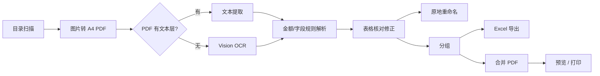

<div align="center">


# 发票报销助手 · InvoiceOrganizer

**一站式发票整理与报销打印工具 —— 把「逐个打开、手动加总、逐个打印」变成一条流水线。**

[](#)
[](#)
[](#)
[](#)
[](LICENSE)
[](#)

</div>

---

## 为什么做这个

报销时的真实痛点：一个目录里躺着几十张发票——PDF 电子发票、图片发票、火车票、微信/银行转账截图。要打印得**逐个打开逐个打**，要算总额得**拿计算器一张张加**。

InvoiceOrganizer 把整个流程自动化：

```
选目录 → 图片转 PDF → 金额识别 → 核对/修正 → 重命名 → 分组 → 导出 Excel → 合并 → 打印
```

全程**纯本地、离线**运行，发票数据不出你的电脑。

## 功能一览

| | 功能 | 说明 |
|---|---|---|
| 📥 | **目录导入** | 选择 / 拖拽目录，记住最近使用，支持 PDF / JPG / PNG / HEIC / TIFF |
| 🖼 | **图片转 PDF** | 统一 A4、保持比例、**只缩不放**，转账截图也能转 |
| 🔍 | **金额智能识别** | PDF 文本层 → Vision OCR → 规则解析，带置信度标记 |
| 🧾 | **扩展字段** | 发票号码、开票日期、销售方名称（含竖排票面布局） |
| ⚠️ | **重复发票检测** | 相同发票号码自动标橙，侧栏一键筛选 |
| 👁 | **排除开关** | 点眼睛置灰：不计总数 / 不重命名 / 不导出 / 不打印 |
| ✏️ | **表格编辑** | 金额、备注直接改，支持从 Excel 复制粘贴一列金额 |
| 🏷 | **批量重命名** | 原地改名 `01-123.45-原名.pdf`，**一键撤销** |
| 🗂 | **分组小计** | 手动分组、自定义组名，组小计 + 多币种总计 |
| 📊 | **Excel 导出** | 真 `.xlsx`（9 列），分组小计 + 总计 SUM 公式 |
| 📄 | **合并预览** | 类 Preview 缩略图预览，可另存，支持按组合并/导出 |
| 🖨 | **批量打印** | Scale to fit / 百分比 / 实际大小，彩色/灰度，双面，A4/A5/Letter/横向，**设置记忆** |
| 🗑 | **安全删除** | Delete 键 / 右键删除，移到废纸篓可恢复 |

## 识别能力（真实票据实测）

| 票据类型 | 金额口径 | 实测 | 置信度 |
|---|---|:---:|:---:|
| 增值税电子发票 | 价税合计（小写） | ¥300.00 ✅ | 高 |
| 铁路电子客票 | 票价 | ¥268.00 ✅ | 高 |
| 微信 / 银行转账截图 | 转账金额 | ¥153.00 ✅ | 中 |
| 欧洲发票（德国 Rechnung） | Gesamtbetrag | €7.60 ✅ | 高 |

- **欧式金额**：`7,60 €` / `1.234,56 €` / `€12.50` / `99.99 EUR` 全支持
- **多币种**：人民币与欧元分别求和（`¥568.00 + €7.60`），不会混加
- **识别链路**：`PDF 文本层提取 → Vision OCR（中文）→ 关键词优先级解析 → 手动兜底`
- 识别失败或低置信度会明确标记，可在表格里直接修正

## 快速开始

**环境要求**：macOS 26.2+ · Xcode 26+

```bash
git clone https://github.com/liu6x6/InvoiceOrganizer.git
cd InvoiceOrganizer/InvoiceOrganizer

# 构建
xcodebuild -project InvoiceOrganizer.xcodeproj -scheme InvoiceOrganizer -configuration Debug build

# 运行
open ~/Library/Developer/Xcode/DerivedData/InvoiceOrganizer-*/Build/Products/Debug/InvoiceOrganizer.app
```

或直接用 Xcode 打开 `InvoiceOrganizer.xcodeproj` 按 ⌘R。

**命令行启动**（可直接指定发票目录）：

```bash
open InvoiceOrganizer.app --args /path/to/发票目录
open InvoiceOrganizer.app --args /path/to/发票目录 --preview   # 同时打开合并预览
```

仓库自带合成样本 `SampleInvoices/`（增值税发票、火车票、微信/银行转账截图），可直接用来体验完整流程。

## 技术架构

- **SwiftUI + `@Observable`**（MVVM），Swift 6.2 并发（`nonisolated` 服务跑后台）
- **零第三方依赖**，全部系统框架：

| 模块 | 技术 |
|---|---|
| PDF 读取 / 文本提取 / 合并 / 预览 | PDFKit |
| 图片转 PDF / 打印重排 | CoreGraphics |
| OCR | Vision（`zh-Hans`） |
| Excel 生成 | **手写 OOXML + ZIP**（Compression 框架 deflate + CRC32） |
| 打印 | NSPrintOperation + Quartz 灰度渲染 |
| 持久化 | SwiftData/JSON + UserDefaults + security-scoped bookmark |



## 项目结构

```
InvoiceOrganizer/
├── icon.svg                  # App 图标（SVG 源）
├── SampleInvoices/           # 合成演示样本
├── REQUIREMENTS.md           # 需求文档（含决策记录）
└── InvoiceOrganizer/         # Xcode 工程
    ├── InvoiceOrganizer/
    │   ├── Models/           # InvoiceItem / Project / PrintSettings
    │   ├── Services/         # 无 UI 依赖的核心逻辑（可单测）
    │   │   ├── FileScanner            目录扫描、自然排序
    │   │   ├── ImageToPDFConverter    图片 → A4 PDF
    │   │   ├── AmountParser           金额提取（中/欧，关键词优先级）
    │   │   ├── InvoiceFieldParser     号码/日期/销售方
    │   │   ├── AmountRecognizer       文本层 → OCR → 解析
    │   │   ├── Renamer                原地重命名 + 撤销日志
    │   │   ├── XlsxWriter             手写 OOXML + ZIP
    │   │   ├── ExcelExporter          清单 → 表格行（SUM）
    │   │   ├── PDFMerger              PDF 合并
    │   │   ├── PrintService           缩放/灰度重排 + 打印
    │   │   └── ThumbnailCache         缩略图缓存
    │   ├── Store/AppModel    # 中央视图模型
    │   └── Views/            # 主窗口 / 表格 / 侧栏 / 预览 / 打印设置
    └── Tests/main.swift      # CLI 端到端测试 harness
```

## 测试

核心逻辑与 UI 分层，`Tests/main.swift` 是独立 CLI 测试 harness（不编入 App），生成模拟发票并端到端验证：

```bash
cd InvoiceOrganizer
swiftc -o /tmp/invoice-test \
  InvoiceOrganizer/Models/InvoiceItem.swift \
  InvoiceOrganizer/Models/Project.swift \
  InvoiceOrganizer/Services/{FileScanner,ImageToPDFConverter,AmountParser,InvoiceFieldParser,AmountRecognizer,Renamer,XlsxWriter,ExcelExporter,PDFMerger}.swift \
  Tests/main.swift \
  -framework PDFKit -framework Vision -framework ImageIO -framework CoreText -lcompression
/tmp/invoice-test
```

覆盖：金额解析（中/欧）、扩展字段、图片转 PDF（A4 断言）、OCR 识别、重命名/撤销、排除项、xlsx 结构、PDF 合并。

```
解析器 7/7 · 欧元 6/6 · 字段 5/5 · 识别 6/6  ✅
```

## 数据与隐私

- 🔒 **纯本地离线**：识别用系统 Vision，发票数据**绝不上传**
- 沙盒 App，目录访问需用户授权（security-scoped bookmark 持久化）
- 项目数据（金额修正/分组/重命名日志）存于 App Support
- 删除走**废纸篓**，重命名可**一键撤销**

## Roadmap

- [ ] App 图标 PNG 化并接入 `AppIcon.appiconset`（SVG 源已就绪）
- [ ] 更多票种：机票行程单、出租车票、定额发票
- [ ] 多币种汇率换算
- [ ] XCTest 单元测试 target
- [ ] 界面截图补充

## License

[MIT](LICENSE) © xiaolong
